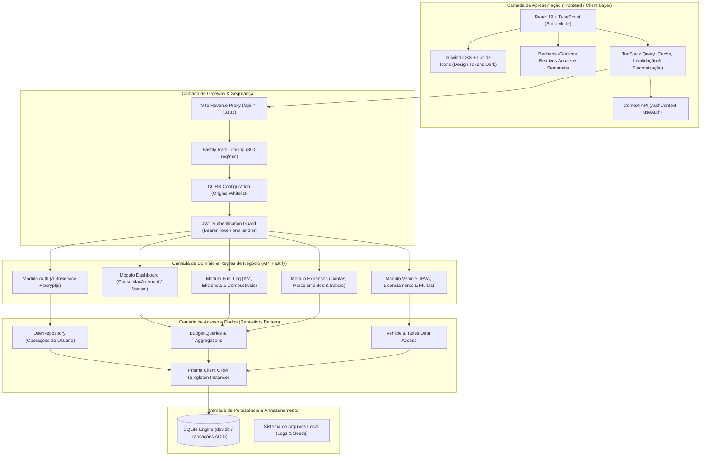
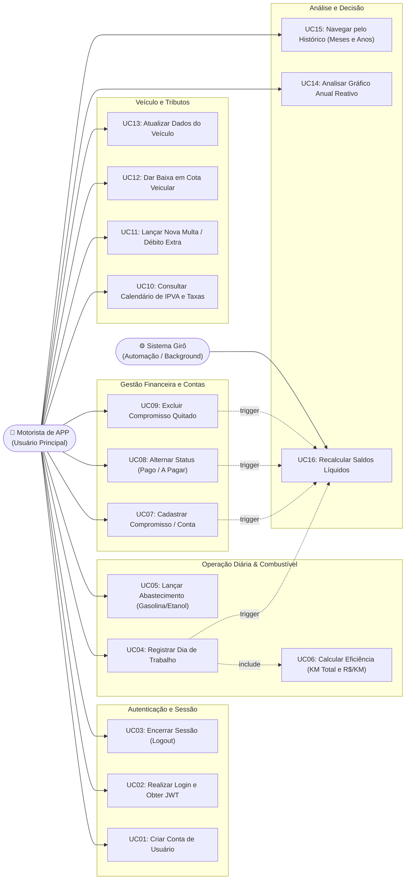
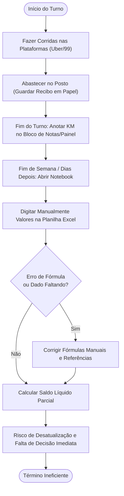
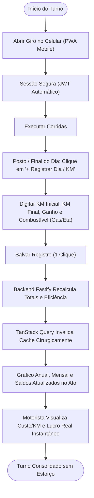
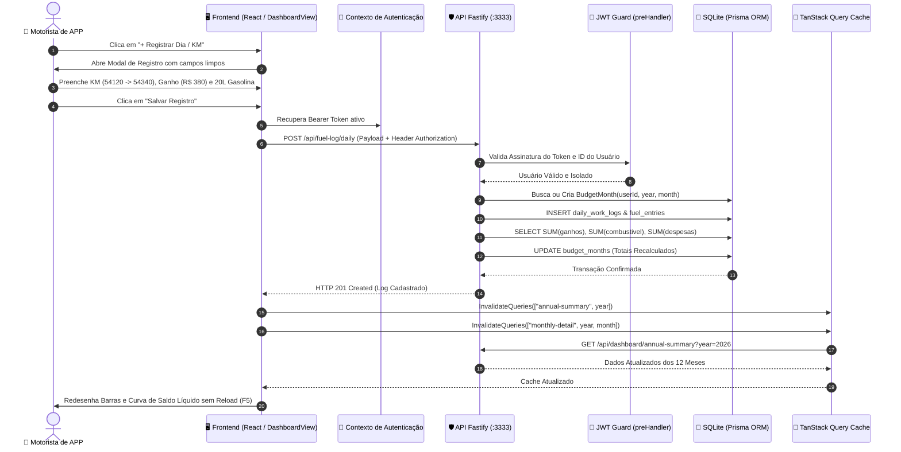
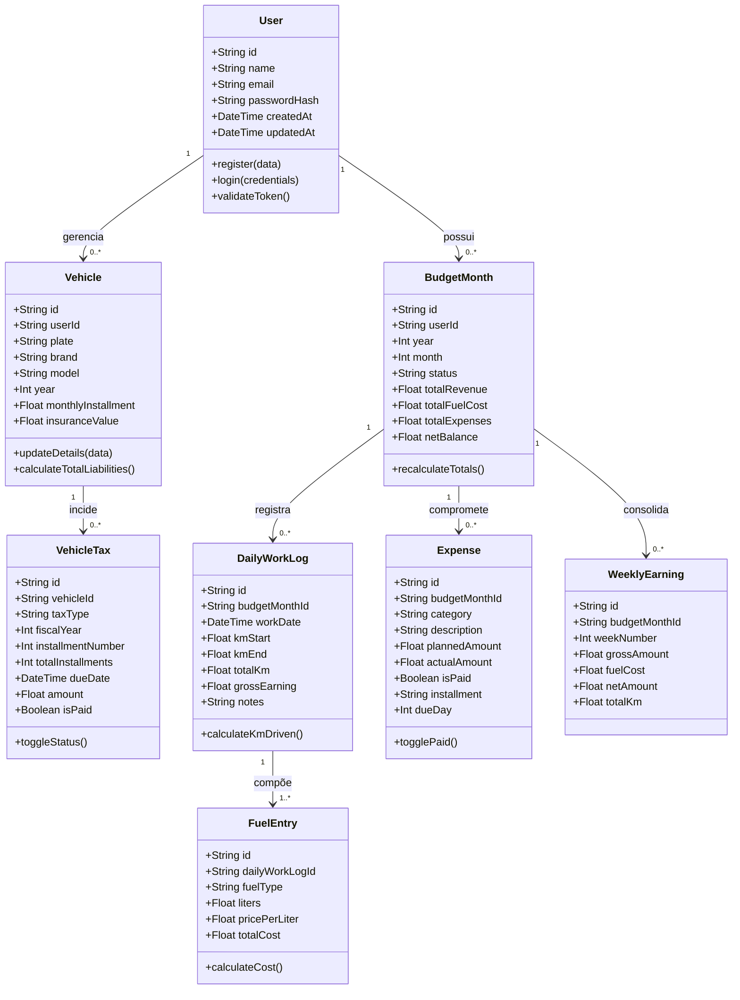
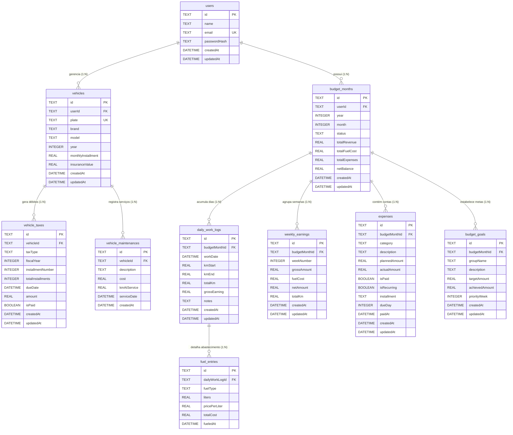

# 📐 Diagramas e Organogramas Técnicos — Girô (v1.0)

Este documento compila todos os diagramas visuais e organogramas de engenharia da plataforma **Girô**, modelados em sintaxe Mermaid para renderização nativa em visualizadores Markdown, GitHub e ferramentas de documentação.

---

## 1. Diagrama de Arquitetura em Camadas (Visão Tecnológica)

---

## 2. Diagrama de Casos de Uso (UML)

---

## 3. Diagrama BPMN — Processo Atual (As-Is) vs. Processo Futuro (To-Be)

### 3.1 Processo Atual (As-Is: Planilha Manual e Caderno)

### 3.2 Processo Futuro (To-Be: Ecossistema Girô em Tempo Real)

---

## 4. Diagrama de Sequência — Lançamento Diário e Atualização em Tempo Real

---

## 5. Diagrama de Classes de Domínio (Entidades de Negócio)

---

## 6. Diagrama Entidade-Relacionamento (Modelo Físico de Dados)

